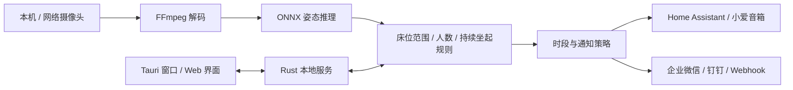

<p align="center">
  
</p>

<h1 align="center">枕安 · PillowGuard</h1>
<p align="center">本地识别老人坐起，让床旁守护及时一点。</p>

枕安是一款用 Rust 开发的床旁姿态监测与通知软件。通过本机或网络摄像头识别床位内的持续坐起，按规则向小爱音箱、Home Assistant、企业微信、钉钉和自定义 Webhook 发送提醒。

视频在运行设备上分析，默认不上传视频，也不保存录像。桌面版使用 Tauri；运行安装包不需要 Python 或 Rust 环境。

**当前版本：0.3.0。仅启用持续坐起提醒。** 当前姿态模型不能保证区分坐姿与站姿；床沿、地面区域只保存备用，不触发离床、站起或跌倒告警。识别受光线、机位和遮挡影响，仍需结合实际照护。

## 功能

| 能力 | 当前行为 |
|---|---|
| 视频来源 | 本机摄像头、RTSP / HTTP 网络摄像头、本地视频回放 |
| 坐起识别 | 确认躺卧后持续坐起触发；可设置持续时间与冷却间隔 |
| 遮挡处理 | 短时保留卧床基线；可选头肩校准辅助、无法识别后坐起告警 |
| 多人暂停 | 床位内多人或人数待确认时暂停；第二人阈值可单独调高 |
| 区域编辑 | 床位、床沿、地面分别绘制 3～12 顶点多边形，床位按实际形状判断 |
| 监测时段 | 全天或最多 16 个每日区间，支持跨午夜、区间重叠合并 |
| 通知渠道 | 多个同类型条目，独立命名、启停、测试和删除 |
| 升级播报 | 告警未解除时，让启用的小爱音箱连续播放多次 |
| 配置保存 | 参数、渠道、凭据和校准永久保存，凭据支持查看、复制、清除 |
| 历史与备份 | 最近 500 条活动、搜索筛选、CSV 导出、规则 JSON 导入导出 |
| 演示与回放 | 无摄像头也可演示；本地视频按视频时间分析并显示进度 |

**演示会向已启用渠道发送真实通知，文案带“演示告警”；视频回放不自动发通知。** 手动测试也会发送真实通知。

## 平台与验证状态

| 平台 | 当前状态 |
|---|---|
| Intel Mac | 已完成原生构建、摄像头使用与 DMG 安装镜像自检；当前安装包目标 macOS 12+ |
| Windows PC | 提供 Tauri 构建和便携 ZIP 脚本，尚未完成 Windows 实机验收 |
| Linux / NAS | 提供无桌面服务、Dockerfile 与 Compose，尚未完成 NAS 实机验收 |
| Apple Silicon Mac / ARM NAS | 需在对应平台构建、验证，当前 Intel 安装包不是通用架构包 |

CI 的编译结果不代表对应设备的摄像头或长期值守已经验收，详见 [验收清单](docs/验收清单.md)。

## 快速使用

### 已有 Mac 安装包

1. 打开 `枕安-0.3.0-Mac-x86_64.dmg`，把「枕安.app」拖入 Applications。
2. 从「应用程序」启动，按系统提示允许摄像头和本地网络访问。
3. 选择视频来源，绘制绿色床位区域，保存后开始监测。
4. 在「通知渠道」添加需要的渠道，保存并单独测试送达。

本地打包版本使用临时签名，尚未 Apple 公证。此仓库不提交安装包、FFmpeg 二进制或模型权重，也尚未发布 GitHub Release；源码构建见下文。

### 第一次配置

- **没有摄像头**：用演示模式先检查规则。测试前只启用允许接收测试消息的渠道。
- **本机摄像头**：点击「使用本机摄像头」。Mac 使用 AVFoundation，Windows 使用首个 DirectShow 视频设备，Linux 默认 `/dev/video0`。
- **网络摄像头**：填写设备提供的 RTSP / HTTP 视频流地址，需要运行设备能访问摄像头局域网。
- **区域**：拖动现有顶点，或沿边界重新描绘；床沿与地面当前只保存备用。参见 [区域设置](docs/区域设置.md)。
- **时段**：选择全天或添加多个区间，如 `13:00～14:00`、`22:00～次日07:00`，按北京时间每天重复。参见 [监测时间段](docs/监测时间段.md)。
- **保存**：点击「保存全部设置」或 Command / Ctrl + S。未保存的编辑不会在重启后保留。

## 判断规则

普通判断先确认躺卧 2 秒，再检测持续坐起。满足所设持续时长且超过告警间隔时，创建一次坐起事件。持续坐着不会不断创建同一事件。

床位与人体框的实际相交面积达到人体框面积的 15% 时，计入床位人数。检测结合关节位置去重，单人置信度默认 0.5，第二人阈值默认 0.75。额外高分框若缺乏可靠人体证据，会显示人数待确认并暂停，避免把不确定识别当成安全。

可选规则包括：

- **遮挡辅助**：固定机位下采集卧床与坐起时的头肩位置，仅保存坐标。改变床位或来源后需重新校准。头肩完全遮住时仍无法判断。
- **无法识别后坐起告警**：持续无法识别至少 2 秒后，再持续检测到单人坐起也可提醒。无人也属于无法识别，因此新进入床位的人可能触发。
- **异常提醒**：持续无人、遮挡、断流或启动失败时提示，可独立关闭。关闭不影响正常坐起提醒。
- **普通重复与升级**：配置重复间隔、次数和升级延迟。音箱升级按文案长度估算播放时长，再等待设定间隔；请求失败或超时停止本轮连播，不自动重试结果不明的请求。
- **人工确认**：默认无需人工确认，可选开启。重新躺卧、多人进入或停止监测会结束当前事件的后续通知；已提交的通知无法撤回。

详见 [当前告警范围与升级策略](docs/分级告警.md)。

## 通知接入

| 渠道 | 需要配置 |
|---|---|
| 小爱音箱 | Home Assistant 地址、长期访问令牌、实际的“播放文本”实体 |
| HA 站内通知 | Home Assistant 地址与令牌 |
| 企业微信群机器人 | 机器人 Webhook 地址 |
| 企业微信应用通知 | CorpID、AgentID、应用 Secret，以及成员 / 部门 / 标签接收对象 |
| 钉钉群机器人 | 机器人地址，可选加签密钥，通知文案需符合机器人关键词设置 |
| 自定义 Webhook | HTTP(S) 地址，接收 `event/title/message/time` JSON |

小爱音箱通过第三方 [Xiaomi Miot](https://github.com/al-one/hass-xiaomi-miot) 接入 Home Assistant；先在 HA 设备页面手动播放文本、实际听到播报，再将该实体填入枕安。`text.xiaoai_play_text` 仅为示例，不是固定实体名。

企业微信应用通知的配置步骤见 [应用通知接入](docs/企业微信应用通知.md)。软件会缓存应用访问凭证，并区分接口拒绝和部分接收对象无效；接口接受不等于成员已阅读。

自动告警与手动测试使用不同文案，支持 `{status}`、`{time}`、`{people}`。HA 令牌不会发送给群机器人或 Webhook。升级连播只使用音箱，不会使群消息跟随连发；普通重复提醒仍按规则发送给启用渠道。

## 数据与隐私

视频在本机推理，所选通知渠道会收到告警文字。配置与历史记录保存位置：

| 运行方式 | 默认数据目录 |
|---|---|
| macOS 桌面 | `~/Library/Application Support/Shouwang` |
| Windows 桌面 | `%LOCALAPPDATA%\Shouwang` |
| Linux 桌面 | `~/.local/share/shouwang` |
| 无桌面服务 | 资源目录下的 `data/`，或 `LAOREN_DATA_DIR` 指定位置 |
| Docker Compose | `laoren-data` 持久数据卷 |

项目原名“守望”。为兼容已安装版本，保留 `Shouwang` 数据目录、`com.laoren.shouwang` 应用标识、旧规则备份格式及 `LAOREN_*` 环境变量；内部可执行文件名仍为 `laoren`，对外应用名称为「枕安」。本地开发目录无需更名。

令牌、Webhook、应用 Secret、摄像头地址单独保存在 `credentials.json`，**本地未加密**；macOS / Linux 按 0600 权限保存。普通状态轮询与规则备份不返回这些凭据。卸载应用不会自动删除数据目录。

服务默认只允许本机访问 `http://127.0.0.1:8765`，同一端口只运行一个实例。NAS 通过管理密码访问；不要直接把未保护的 8765 端口暴露到公网。

## 从源码构建

需要 Rust / Cargo、对应平台的编译工具和 FFmpeg。桌面构建依赖参见 [Tauri 平台准备](https://v2.tauri.app/start/prerequisites/)。Node.js 仅用于运行项目内的 JavaScript 回归检查，前端无需 npm 构建。

```bash
git clone https://github.com/DumKing/pillowguard.git
cd pillowguard
bash tools/download-model.sh
cargo build --release --locked
```

模型下载脚本会检查 SHA-256，不覆盖校验不匹配的已有模型。Windows 可在 Git Bash 中执行脚本。

将相应平台的 FFmpeg 放到 `bin/ffmpeg`（Windows 为 `bin/ffmpeg.exe`），或通过 `LAOREN_FFMPEG` 指定其绝对路径。运行无桌面服务：

```bash
export LAOREN_FFMPEG="/absolute/path/to/ffmpeg"
cargo run --release --locked
```

然后打开 `http://127.0.0.1:8765`。ONNX Runtime 默认由 `ort-sys` 获取预编译库，首次构建需要网络。若使用本地静态库，可设置 `ORT_LIB_LOCATION` 指向包含 `include/`、`lib/` 的安装目录；它必须匹配目标平台和 `ort` 的版本。

### Mac 桌面与安装包

```bash
cargo build --release --features desktop --locked
bash tools/package-macos-dmg.sh release
bash tools/verify-macos-dmg.sh dist/枕安-0.3.0-Mac-x86_64.dmg
```

打包脚本需要 `bin/ffmpeg` 和已下载的模型，输出 `dist/枕安-版本-Mac-架构.dmg` 及 SHA-256 校验文件；上方验证示例针对 Intel Mac。`CARGO_TARGET_DIR` 可覆盖默认构建目录。ZIP 打包见 `tools/package-macos-archive.sh`，图标生成见 `tools/build-icons.sh`。

### Windows 便携包

在 Windows 准备编译工具和 WebView2 后：

```powershell
cargo build --release --features desktop --locked
powershell -File tools/package-windows.ps1 -FfmpegPath C:\path\to\ffmpeg.exe
```

输出 `dist/PillowGuard-Windows.zip`。解压完整文件夹后打开 `PillowGuard.exe`，保留 `bin` 和 `models`，尚需 Windows 实机验证。

### Linux / NAS

```bash
cp .env.example .env
# 编辑 .env，为 LAOREN_PASSWORD 设置至少 12 字符的管理密码
# 首次构建需要访问容器镜像源、Rust 依赖源和模型下载源
docker compose up -d --build
```

打开 `http://NAS地址:8765`，用户名 `admin`，密码使用 `.env` 中的值。默认映射 8765 端口并使用持久卷；USB 摄像头需额外配置设备映射，网络摄像头无需 USB 映射。升级前备份数据卷，重新构建镜像后再启动。

### 环境变量

| 变量 | 用途 |
|---|---|
| `LAOREN_HOME` | 资源目录，包含 `models/` 与 `bin/` |
| `LAOREN_DATA_DIR` | 配置、凭据、历史及告警记录目录 |
| `LAOREN_FFMPEG` | FFmpeg 可执行文件路径 |
| `LAOREN_BIND` | 服务监听地址，默认 `127.0.0.1` |
| `LAOREN_PASSWORD` | 服务访问密码，NAS 非本机访问时使用 |
| `ORT_LIB_LOCATION` | 构建时 ONNX Runtime 安装目录 |
| `CARGO_TARGET_DIR` | Cargo 构建产物目录，打包脚本也读取该值 |

## 架构与目录



- `src/main.rs`：服务、配置、视频任务与通知编排。
- `src/vision.rs`、`src/rules.rs`、`src/region.rs`：推理、状态机、人数判断与多边形相交。
- `src/assist.rs`、`src/care.rs`：头肩辅助校准与单次告警生命周期。
- `src/channels.rs`、`src/notifications.rs`、`src/wecom_app.rs`：多渠道、机器人协议与企业微信应用消息。
- `src/credentials.rs`、`src/history.rs`：凭据和历史持久化。
- `web/`：无需前端构建工具的管理界面。
- `assets/`：图标原图、各平台图标和设计说明。
- `tools/`：模型下载、图标生成、Mac / Windows 打包与镜像自检。
- `tests/`：本地模拟服务、页面契约和功能回归脚本。
- `docs/`：通知接入、告警范围、区域、时段和验收说明。

`data/`、`work/`、`bin/`、`models/`、`dist/` 与历史 Python 原型均不提交到 Git。

## 验证

```bash
cargo fmt --check
cargo test --locked
node tests/ui-contract.cjs
```

接口回归需要先停止占用 8765 的应用，并准备无桌面测试程序：

```bash
cargo build --locked
mkdir -p bin
cp target/debug/laoren bin/laoren-server
node tests/channels-smoke.cjs
node tests/schedule-smoke.cjs
node tests/regions-smoke.cjs
node tests/unknown-smoke.cjs
node tests/care-smoke.cjs
```

这些脚本使用临时配置与本地模拟接收端；不读取桌面版真实凭据。Windows 运行脚本需调整测试可执行文件路径。CI 提供平台单测、服务构建和 Mac / Windows 桌面编译检查；桌面编译检查跳过安装包运行资源复制，打包时仍需真实模型与对应系统的 FFmpeg。硬件与真实通知送达需单独验收。

## 常见问题

- **提示端口被占用**：退出其他枕安或旧版守望实例后再打开。
- **Mac 摄像头或 HA 不可用**：检查「系统设置 → 隐私与安全性 → 摄像头 / 本地网络」中的应用权限。
- **单人被误判为多人**：准确描绘床位，提高第二人阈值前先检查画面；阈值过高也可能漏掉真实照护人。
- **被子盖住后没有告警**：普通规则需要卧床基线，可考虑头肩辅助或“无法识别后坐起”选项；头肩完全不可见时不能保证识别。
- **已发送却没听到声音 / 收到消息**：请求接受只说明接口受理。核实实体、音箱在线状态、应用可见范围、机器人安全设置与企业可信 IP。
- **修改没有保留**：点击保存，确认页面显示“设置已保存”；查看凭据不会自动更改已保存值。

## 模型与第三方许可

模型来自 [Xenova/yolov8-pose-onnx](https://huggingface.co/Xenova/yolov8-pose-onnx)，上游标记为 AGPL-3.0；当前模型 SHA-256：

```text
04f6d2416266f2aba6c5ba8b26de33ed9eba3279f972ac02e33f9f1366547586
```

[ONNX Runtime](https://github.com/microsoft/onnxruntime/blob/main/LICENSE) 使用 MIT 许可；FFmpeg 许可随所选构建及编译选项而异。仓库未捆绑这些第三方二进制，分发完整安装包时应保留相应许可与所需材料。图标由生成式工具设计，说明见 [图标设计记录](assets/icon-design-v1.md)。

仓库当前未为项目源码指定单独的开源许可证。
